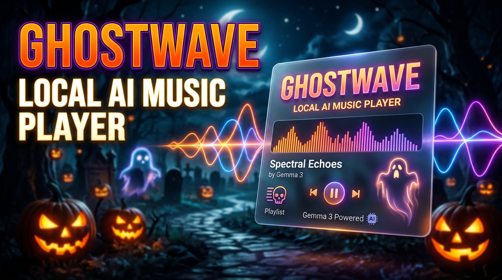

# 🎃 GhostWave — Local-First Music Player & AI Crate Curator



<p align="center">
  <strong>A spooky, local-first music player, crate manager, and audio-reactive visualizer powered by local open-weight AI (Gemma 3 via Ollama).</strong>
</p>

<p align="center">
  <a href="#-the-ghost-in-the-machine-origin-story">The Origin Story</a> •
  <a href="#-key-features">Key Features</a> •
  <a href="#-architecture">Architecture</a> •
  <a href="#-getting-started">Getting Started</a> •
  <a href="#-running-local-ai-gemma-3">Local AI Setup</a> •
  <a href="#-tauri-desktop-app">Tauri Desktop</a> •
  <a href="#-testing--verification">QA & Testing</a> •
  <a href="#-deployment-render">Deployment</a>
</p>

---

## ⚡ The "Ghost in the Machine" Origin Story

It was Halloween Eve. Outside, a violent seasonal thunderstorm battered the neighborhood. Then the grid blinked—and the house plunged into darkness. 

When the power snapped back on ten minutes later, the fiber internet connection remained completely dead. We were supposed to host an intimate Halloween gathering with friends. My friend pulled out her phone to start the music playlist on a major cloud streaming app: **buffering error 404, no connection**. 

I plugged in my offline backup drive filled with gigabytes of local music: thousands of anime themes, Vocaloid tracks, electronic synths, and classical recordings. But we ran into an immediate wall: 
- Half the files had missing ID3 tags or Japanese unicode filenames (`Matsuri（Official Video）(MP3_160K).mp3`).
- We wanted a high-energy, fast-paced electronic Halloween workout playlist, but nobody wanted to spend 45 minutes manually browsing through 2,000 files in a generic file manager.
- Every mainstream "smart" playlist generator requires an active internet connection to cloud LLMs that scrape your data and fail when your modem goes red.

**Why should playing and organizing your own local music depend on external servers?**

That night, **GhostWave** was born:
A **local-first, offline-capable music player** that pairs a high-performance audio engine and Halloween-inspired reactive visualizer with **local open-weight AI (Google's Gemma 3 4B running on your local machine via Ollama)**. When the storm hits and the internet dies, the ghost in the machine awakens—curating smart playlists, diagnosing missing metadata, and running reactive visualizers directly on your local hardware.

---

## 🎧 Key Features

### 1. 🗄️ Crate Deck (Local Music Vault)
- **Zero-Cloud Audio Indexing:** Reads MP3, FLAC, WAV, OGG, and AAC directly into an IndexedDB catalog via `music-metadata-browser`.
- **Zero File Mutation Invariant:** Your source music library is treated as a read-only vault. Files are never overwritten or deleted without explicit user confirmation.
- **Deep Search & Filtering:** Instant fuzzy filtering by title, artist, album, format pill filters, and customizable sort orders.
- **Dual View Modes:** Seamlessly switch between compact DJ Table view and rich Album Art Grid cards.

### 2. 🎛️ Audio Deck & Slide-Up Spectral Visualizer
- **Web Audio API Engine:** Real-time decoding, elapsed time tracking, seamless track queueing, volume control with mute toggle, shuffle, and cycle repeat modes (Off / All / Track).
- **Halloween Audio-Reactive Visualizers:** Real-time frequency analysis with selectable styles (Waveform, Neon Bats, Spectral Columns, and Spooky Jack-o'-Lantern pulses) in Dark and Light Halloween palettes.
- **Queue Management:** Slide-up queue drawer with drag reordering, removal, and auto-population from crates.

### 3. 🤖 Local AI Playlist Curator (Gemma 3 + Ollama)
- **100% Offline AI Invocations:** Communicates with your local Ollama daemon (`http://127.0.0.1:11434`) using `gemma3:4b`.
- **Natural-Language Understanding:** Ask for *"Fast electronic workout tracks with punchy bass"* or *"Spooky atmospheric ambient tracks under 30 minutes"*.
- **Strict Structured Schema:** Gemma 3 outputs deterministic JSON schemas with `crateName`, `description`, `trackIds`, and reasoning.
- **Hallucination Shield:** Output track IDs are strictly validated against existing IndexedDB records. Any fabricated tracks are discarded before presentation.
- **Human-in-the-Loop Review:** Preview proposed track selections, verify duration limits, and save proposals to Crates with one click.

### 4. 🩺 Library Health & Non-Destructive Tagging
- **Deterministic Health Audits:** Flags missing tags, unicode inconsistencies, duplicate hashes, and metadata collisions.
- **Side-by-Side Tag Diff Inspector:** Compare current metadata with proposed fixes before committing changes.
- **Safe Renaming Templates:** Preview filename changes (e.g. `{artist} - {title}`) with collision detection before disk writing.

### 5. 🌐 Online Enrichment & External Intelligence (Optional)
- **MusicBrainz Integration:** Query open recording databases with rate-limit compliance.
- **Cover Art Archive & LRCLIB:** Preview verified community release artwork and plain/synced lyrics.
- **SerpApi Search Partner:** Search Google Knowledge Graph and organic web results for unindexed tracks; keys remain masked in local browser storage.
- **Graceful Offline Degradation:** If internet is absent, all core local audio and AI features continue working seamlessly.

### 6. 🔄 16-Bit PCM Audio Converter
- **Non-Destructive Transcoding:** Converts input audio to uncompressed WAV or OGG using Web Audio API buffer rendering.
- **Configurable Audio Specs:** Sample rate (44.1kHz, 48kHz, 96kHz), channels (Mono/Stereo), and custom filename suffixes.

### 7. 📊 History & Transparent Recommendations
- **Local Scrobbling:** Automatically records completed plays (>= 30s or >= 50% duration) versus skips.
- **Listening Analytics:** Tracks total listening sessions, hours, skip rates, and favorite genres.
- **Transparent Recommendations:** Offline recommendation engine prioritizing unplayed gems with clear human-readable rationales.
- **Local Control:** Toggle history tracking on/off anytime or purge records with one click.

### 8. 🛡️ Privacy-First Sentry Telemetry
- **Diagnostic Observability:** Monitors application crashes and AI prompt latencies.
- **Sanitized Telemetry:** Local filesystem paths, audio bytes, filenames, listening history, and user prompt strings are scrubbed by `beforeSend` filters.
- **User Controlled:** Can be disabled at any time in Settings.

---

## 🏛️ Architecture

GhostWave uses a **modular, skeleton-first container architecture**:

```
GhostWave Architecture
│
├── src/
│   ├── components/
│   │   ├── common/           # Dialogs, modals, ScanModal, OnlineEnrichmentModal
│   │   ├── layout/           # AppShell, SidebarDeck, PlayerControls, VisualizerDrawer
│   │   └── player/           # Canvas visualizer renderers, audio transport
│   ├── context/
│   │   └── AppContext.tsx    # Single source of truth (Library, Queue, Settings, Toast)
│   ├── screens/
│   │   ├── LibraryScreen.tsx # Crate deck table/grid view
│   │   ├── PlaylistsScreen   # Saved crates management
│   │   ├── HealthCleanup     # Health audit and proposed tag diffs
│   │   ├── LocalAiScreen.tsx # Ollama Gemma 3 natural-language agent
│   │   ├── ListeningHistory  # Playback analytics and recommendations
│   │   └── SettingsScreen    # Platform config, Ollama endpoint, Sentry, SerpApi
│   ├── services/
│   │   ├── ai/               # OllamaClient, AiPlaylistService, prompt templates
│   │   ├── audio/            # AudioPlayerEngine, AudioConversionService
│   │   ├── enrichment/       # MusicBrainz, SerpApi, CoverArtArchive, LRCLIB
│   │   ├── history/          # HistoryService, scrobbling, recommendations
│   │   ├── platform/         # WebFilePlatform vs TauriFilePlatform adapters
│   │   └── telemetry/        # SentryTelemetry with privacy sanitizers
│   └── types/                # Domain models: Track, Crate, Proposal, PlaybackEvent
└── src-tauri/                # Native Tauri 2 Rust desktop wrapper
```

---

## 🚀 Getting Started

### Prerequisites
- **Node.js:** v20+ or v22+
- **npm:** v9+
- *(Optional for AI)* **Ollama:** Installed locally from [ollama.com](https://ollama.com)

### Installation & Local Web Dev

```bash
# Clone the repository
git clone https://github.com/edgiaxel/GhostWave.git
cd GhostWave

# Install dependencies
npm install

# Start Vite development server
npm run dev
```

Open your browser at `http://localhost:5173`.

---

## 🤖 Running Local AI (Gemma 3)

GhostWave connects to Ollama over its standard local API endpoint (`http://127.0.0.1:11434`).

1. Install Ollama:
   ```bash
   curl -fsSL https://ollama.com/install.sh | sh
   ```
2. Pull the Gemma 3 4B model:
   ```bash
   ollama pull gemma3:4b
   ```
3. Start the Ollama server:
   ```bash
   ollama serve
   ```
4. In GhostWave, open **Settings & Platform** $\rightarrow$ **Local AI (Ollama)**:
   - Endpoint: `http://127.0.0.1:11434`
   - Model: `gemma3:4b`
   - Click **Test Connection** to confirm connectivity.

---

## 🖥️ Tauri Desktop App

GhostWave is packaged as a native desktop application using **Tauri 2**.

### Build Desktop Binaries (Linux / Windows)

```bash
# Install Linux development dependencies (Ubuntu/Debian)
sudo apt-get install -y libwebkit2gtk-4.1-dev libappindicator3-dev librsvg2-dev patchelf libgtk-3-dev

# Build native desktop package (.deb, .AppImage, or .exe)
npx tauri build
```

Generated packages will be located in:
`src-tauri/target/release/bundle/`

### Automated GitHub Actions CI
The repository includes automated CI in [`.github/workflows/desktop-build.yml`](.github/workflows/desktop-build.yml) compiling native releases for both Ubuntu Linux and Windows x64.

---

## 🧪 Testing & Verification

GhostWave enforces a zero-mock integration policy with automated regression suites:

```bash
# Run Vitest unit & integration suites (12 suites, 121 tests)
npm test

# Run Playwright End-to-End browser suites (10 suites, 30 tests)
npm run test:e2e
```

### Test Coverage Highlights:
- **Suite 01:** Shell navigation, theme toggling (Dark/Light Halloween), split pane resize handles, settings persistence.
- **Suite 02:** Real library import from 74-track audio vault, multi-field search, format filters, corrupt file handling.
- **Suite 03:** Audio playback progression, next/previous tracks, seek bar, volume, shuffle, repeat, slide-up visualizer drawer.
- **Suite 04:** Crate creation, adding tracks, reordering, title edits, deletion confirmation.
- **Suite 05:** Library health audits, tag proposal diffs, inline edits, safe rename previews.
- **Suite 06:** Audio conversion to 16-bit PCM WAV, non-destructive source file preservation.
- **Suite 07:** Playback scrobbling (30s/50% boundary), skip rates, transparent recommendation engine.
- **Suite 08:** Real local Ollama daemon connection, Gemma 3 4B inference, structured JSON validation.
- **Suite 09:** MusicBrainz candidate matching, Cover Art Archive, LRCLIB synced lyrics, SerpApi credentials.
- **Suite 10:** Sentry envelope verification, "Break the world" error test, and privacy path scrubbers.

---

## ☁️ Deployment (Render)

GhostWave is deployed as a static web application on **Render**:

- **Blueprint File:** [`render.yaml`](render.yaml)
- **Publish Path:** `./dist`
- **Build Command:** `npm install && npm run build`
- **SPA Routing:** Configured via `render.yaml` routes rewrite and `public/_redirects` (`/* /index.html 200`).

---

## 📜 License

MIT License. Developed for the **Hacktoberfest Open-Source AI Challenge Week 4: Ghost in the Machine**.
